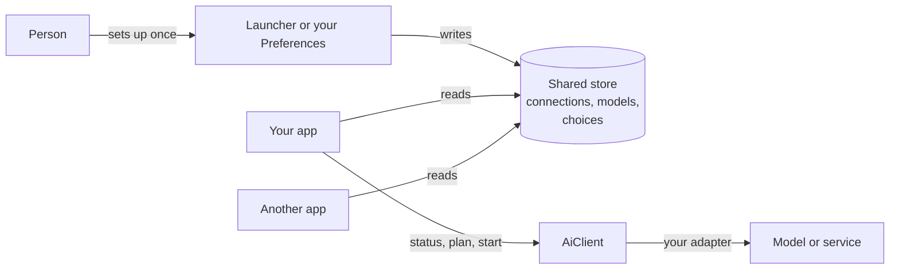

# Adopting the Craft AI layer

You want an AI tool in your app, and you want it to work the way the rest of the suite does:
a person sets up a model once, and your tool uses it.

This section is for **developers**. It covers adding a tool to an app, declaring a new kind of
tool, and bringing a service or model that can run one. You do not need to edit this repository,
the launcher or anyone else's app.

## The idea in one minute



Five things, in the order you meet them:

| Word | Meaning |
|---|---|
| **Tool** (a `Role`) | A job your app offers, such as "Select subject". It has an id, one capability and the inputs it sends. |
| **Connection** | A place that can run models: a hosted service, a server on this computer, or the built-in engine. It holds the models it offers. Keys live in the keychain, not here. |
| **Binding** | The person's choice of connection and model for one tool. A suite default, with an optional override per app. |
| **Adapter** (a `Provider`) | The code in your app that talks to a connection. An app that has no adapter for a connection says so plainly. |
| **Job** | One run. You start it, poll it, and can cancel it. |

Your app owns the interface and the result. The shared layer owns everything between.

| The shared layer does | Your app does |
|---|---|
| Stores connections, models, choices, consent and history | Draws the tool: a prompt bar, a button, a click on the image |
| Reads keys, only at the moment a job starts | Builds the request from its own document |
| Checks the model can take your inputs | Shows the disclosure and asks for consent |
| Refuses to send data without consent | Applies the result, with its own undo |
| Runs and tracks the job | Offers cancel, progress and readable errors |

## Pick your path

| I want to... | Read | Time |
|---|---|---|
| Add a tool that already exists (Select subject, Remove objects) to my app | [Use AI tools in your app](use-in-your-app.md) | 30 minutes to a first run |
| Offer a kind of tool the suite does not have yet | [Declare a new tool](declare-a-tool.md) | 15 minutes |
| Make my service, API, server or model runnable by the tools | [Bring a service or model](bring-a-service.md) | 1 hour for a `Provider` |
| Check I did it properly before I ship | [Checklist](checklist.md) | 10 minutes |
| Work out why it says "Unavailable" | [Troubleshooting](troubleshooting.md) | 5 minutes |

Most people need the first guide and the checklist.

## See it run first

Every page here is checked by the compiler. The whole story, with two independent apps and a
third one that cannot run the service, is one test:

```sh
cargo test -p craft-ai-client --test third_party_adoption -j 8
cargo test -p craft-ai-client --doc -j 8
cargo run  -p craft-ai-client --example custom_tool -j 8
```

None of them touches the network or your real connections. They use a temporary folder and a
scripted stand-in service. If a page and the code disagree, the code is right and the page has
a bug. Please fix the page.

## What you get, and what you do not

You get: one place where keys, models and choices live; consent that is scoped to your app, the
connection, the destination and the kind of data; a job model that works for a two-second edit
and a two-minute video; a log; and shared checks that any adapter can run.

You do not get, today:

- A background service. The runtime is **in the app's own process**. Your app links
  `craft-ai-client` and runs its adapters itself. A shared daemon is a separate discussion.
- Dynamic code loading. A tool is a declaration, and an adapter is code you compile into your app.
- Automatic model installation. Setting up a model is the launcher's Set up AI window, or your
  own screen built from the shared pieces, and it always asks first.
- A stable API. The contract is accepted in `craft-libs`, but this workspace still carries
  newer additions that are under review ([CORE-SYNC](../CORE-SYNC.md)). Pin a revision.

Read [STATUS](../STATUS.md) before you rely on a provider. It lists what ran against a scripted
server, what ran for real on one machine, and what has not run at all. Your own docs should use the
same levels, and never claim more.

## Ground rules

These come from the people who use the suite. The checks enforce most of them.

1. **One model choice, everywhere.** Never hard-code a model or an address. Read the binding.
2. **No silent substitution.** If the chosen model cannot run, say so. Do not run a different one.
3. **Nothing leaves the computer without a yes.** The layer enforces consent. Do not route around it.
4. **Keys never travel.** Not through environment variables you set, command lines, logs or errors.
5. **Plain words.** Everything a person reads avoids engine names, hardware words and developer terms.
6. **Every app works with no AI.** An unset tool is greyed out with a reason, never broken.
7. **Say what you ran.** Configured, verified and executable are three different claims.

## Where things live

| Folder | What is in it |
|---|---|
| `crates/ai-core` | The data model and the `Provider` trait. No I/O. Builds for wasm. |
| `crates/ai-client` | `AiClient`, `ToolDesk` and `ProviderFactory`. What an app holds. |
| `crates/ai-features` | The catalogue of tools and how each can be set up. |
| `crates/ai-native` | The shared store file, key stores, consent and history files. |
| `crates/ai-egui` | Optional theme-neutral widgets. |
| `docs/` | These guides, the [layout](../LAYOUT.md), the [platform contract](../PLATFORM-CONTRACT.md) and [custom connections and sources](../custom-connections-and-sources.md). |

## Getting help and giving back

Open an issue on `storytold/craft-ai-integrations`. Say which guide you followed, which step was
unclear and what you expected. A step that needed something the page did not say is a bug in the
page. Small fixes to these pages are welcome as pull requests. See [CONTRIBUTING](../../CONTRIBUTING.md).
